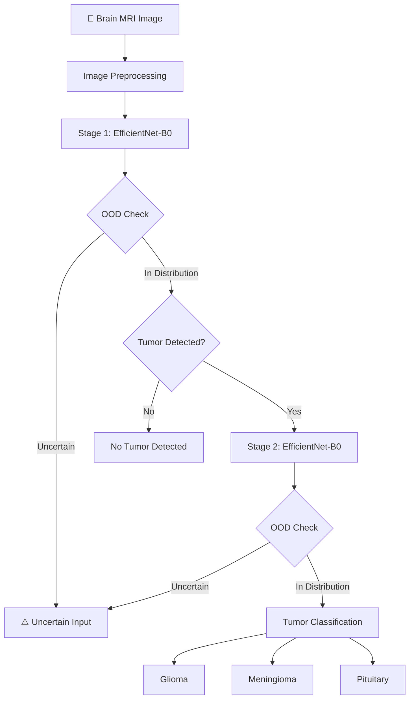
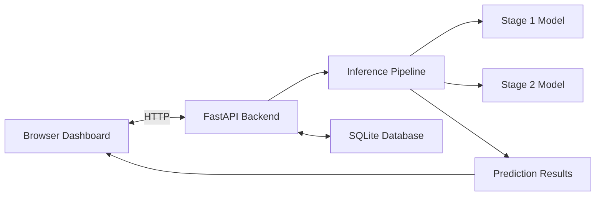

# 🧠 NeuroScan AI

### Intelligent Brain MRI Screening & Tumor Classification

\<div align="center">

\

**A two-stage deep learning system designed to bring intelligent MRI screening into an accessible web-based environment.**

\<br/>


\


\


\</div>

---

## 🔬 Overview

**NeuroScan AI** is a deep learning-based brain MRI screening application that combines two EfficientNet-B0 models in a sequential classification pipeline.

Rather than relying on a single classifier, the system uses a two-stage approach:

- **Stage 1:** Screens MRI images for tumor presence or absence.
- **Stage 2:** Classifies detected tumors into glioma, meningioma, or pituitary tumor categories.
- **OOD Detection:** Uses energy-based out-of-distribution detection to identify inputs that fall outside the expected data distribution.

The original Windows executable has been reimplemented as a full-stack web application using FastAPI, allowing users to access the screening dashboard through a browser.

> The application is intended for research and educational exploration, not independent clinical diagnosis.

---

## ⚡ Key Features

\<table>
\<tr>
\<td width="50%">

### 🧠 Two-Stage AI Pipeline

Sequential EfficientNet-B0 models for binary screening and tumor classification.

\</td>
\<td width="50%">

### 🛡️ OOD Detection

Energy-based checks to flag unexpected or unsuitable inputs as uncertain.

\</td>
\</tr>
\<tr>
\<td width="50%">

### 📊 Scan History

SQLite-based storage for previous screening records.

\</td>
\<td width="50%">

### 🌐 Web Dashboard

Browser-accessible interface powered by a FastAPI backend.

\</td>
\</tr>
\<tr>
\<td width="50%">

### ⚙️ Original Model Weights

Uses the original trained `.pt` weights and deployment configuration bundles.

\</td> \<td width="50%">

### 🐳 Docker Support

Containerized deployment for compatible Linux environments.

\</td> \</tr> \</table>

---

## 🧬 AI Architecture

NeuroScan AI uses a cascaded classification architecture to separate initial tumor screening from subsequent tumor-type classification.



### Stage 01 — Binary Screening

**EfficientNet-B0 | Tumor vs. No Tumor**

The first model evaluates the MRI image and determines whether it should proceed to further tumor classification.

- Binary classification.
- High-sensitivity threshold calibration.
- Original deployment temperature and threshold configuration.
- Energy-based OOD checking.

### Stage 02 — Tumor Classification

**EfficientNet-B0 | Three-Class Classification**

Activated only when Stage 1 flags a potential tumor.

| Class | Classification |
| ----- | -------------- |
| 01    | Glioma         |
| 02    | Meningioma     |
| 03    | Pituitary      |

### Out-of-Distribution Detection

The system incorporates energy-based OOD checks at both stages.

Unexpected inputs are flagged as uncertain instead of being automatically forced into a tumor category.

---

## 📈 Model Configuration & Performance

The original Stage 1 deployment bundle contains calibration targeting approximately:

| Metric             | Configuration              |
| ------------------ | -------------------------- |
| Target sensitivity | \~99.9%                    |
| Target specificity | ≥90%                       |
| Architecture       | EfficientNet-B0            |
| Classification     | Binary                     |
| Calibration        | Original deployment bundle |

\<details> \<summary>\<b>Technical implementation details\</b>\</summary>

- Original Stage 1 and Stage 2 `.pt` model weights.
- Original `deployment_bundle.json` configuration files.
- Temperature scaling and classification thresholds loaded from the original bundles.
- Energy-based OOD cutoffs loaded from deployment configurations.
- Preprocessing reconstructed from `common.yaml`.

**Evaluation note:** The performance figures above describe the original bundle's validation configuration. They have not been independently re-established through a new held-out test evaluation of this web implementation.

\</details>

---

## 🛠️ Technology Stack

\<div align="center">

### Programming Languages

\

### AI & Deep Learning

\ \ \

### Backend & Deployment

\

\</div>

| Technology      | Purpose                              |
| --------------- | ------------------------------------ |
| Python          | Core application and model inference |
| PyTorch         | Deep learning framework              |
| EfficientNet-B0 | MRI classification architecture      |
| FastAPI         | Backend and API endpoints            |
| JavaScript      | Dashboard interactions               |
| HTML & CSS      | Frontend interface                   |
| Chart.js        | Data visualization                   |
| SQLite          | Scan history storage                 |
| Docker          | Containerized deployment             |

---

## 🖥️ Application Architecture



### API Endpoints

| Endpoint                       | Function                        |
| ------------------------------ | ------------------------------- |
| `POST /api/predict`            | Upload and analyze an MRI image |
| `GET /api/history`             | Retrieve previous scans         |
| `GET /api/stats`               | Retrieve dashboard statistics   |
| `GET /api/history/{id}/report` | Retrieve a scan report          |

---

## 📂 Project Structure

```text
NeuroScan-AI/
│
├── app/
│   ├── backend/
│   │   ├── main.py
│   │   ├── inference.py
│   │   ├── database.py
│   │   ├── requirements.txt
│   │   │
│   │   ├── configs/
│   │   │   ├── common.yaml
│   │   │   ├── stage1/
│   │   │   └── stage2/
│   │   │
│   │   └── model_weights/
│   │       ├── stage1/
│   │       │   ├── stage1_efficientnet_b0_best.pt
│   │       │   └── deployment_bundle.json
│   │       │
│   │       └── stage2/
│   │           ├── stage2_efficientnet_b0_best.pt
│   │           └── deployment_bundle.json
│   │
│   └── frontend/
│       └── index.html
│
├── Dockerfile
└── README.md
```

---

## 🚀 Getting Started

### Prerequisites

- Python 3.11 or newer.
- Git.
- Docker (optional).

### 1. Clone the Repository

```bash
git clone https://github.com/mehmoodwahaj806-ai/YOUR_REPOSITORY.git
cd YOUR_REPOSITORY
```

### 2. Install Dependencies

```bash
python -m pip install -r app/backend/requirements.txt
```

### 3. Start the Backend

```bash
cd app/backend
python -m uvicorn main:app --host 127.0.0.1 --port 8000
```

### 4. Open the Dashboard

Navigate to:

```text
http://127.0.0.1:8000
```

The FastAPI application serves both the frontend dashboard and the backend API.

---

## 🐳 Docker Deployment

Build the Docker image:

```bash
docker build -t neuroscan-ai .
```

Run the container:

```bash
docker run --rm -p 8000:8000 neuroscan-ai
```

Open:

```text
http://localhost:8000
```

The application can also be deployed to compatible Linux hosting platforms, VPS environments, and container services.

---

## ⚙️ Deployment Considerations

| Component        | Implementation      |
| ---------------- | ------------------- |
| Backend          | FastAPI + Uvicorn   |
| Frontend         | Served by FastAPI   |
| Database         | SQLite              |
| Inference        | CPU by default      |
| GPU              | CUDA when available |
| Containerization | Docker              |

For multi-user deployments with concurrent traffic, PostgreSQL is a more appropriate database option than local SQLite.

---

## 🔍 Important Technical Considerations

1. **Clinical validation:** NeuroScan AI is a research and educational software project, not a validated medical device. Its output must not replace professional radiological interpretation.

2. **Independent evaluation:** The original validation metrics have not been independently reproduced on a new held-out dataset for this implementation.

3. **Preprocessing reconstruction:** Preprocessing was reconstructed from `common.yaml`. PIL bilinear interpolation is used as an approximation for the configured area interpolation, so exact equivalence with the original implementation has not been established.

4. **Database scalability:** SQLite is suitable for local and single-instance use. Larger multi-user deployments should consider PostgreSQL.

5. **Deployment security:** Public deployments should add authentication, upload validation, access controls, and secure handling of medical images before accepting real user data.

---

## 🔮 Future Development

- [ ] Independent evaluation on a trusted held-out MRI dataset.
- [ ] Side-by-side verification of preprocessing and model outputs.
- [ ] More detailed prediction visualization.
- [ ] Enhanced scan reporting and export functionality.
- [ ] PostgreSQL integration for scalable deployment.
- [ ] Authentication and secure user management.
- [ ] Further exploration of MRI localization and segmentation.

---

## 👨‍💻 Author

\<div align="center">

**Wahaj Mehmood**

Pre-Medical Student | AI & Healthcare Enthusiast | Aspiring Researcher

Interested in the intersection of neuroscience, medical imaging, artificial intelligence, and healthcare innovation.


---

### 🧠 Exploring the Future of Medical AI

*Where deep learning meets medical imaging.*

\

\</div>

---

\<sub>Disclaimer: NeuroScan AI is an experimental research and educational project. It is not intended for clinical diagnosis, treatment decisions, or emergency medical use.\</sub>
